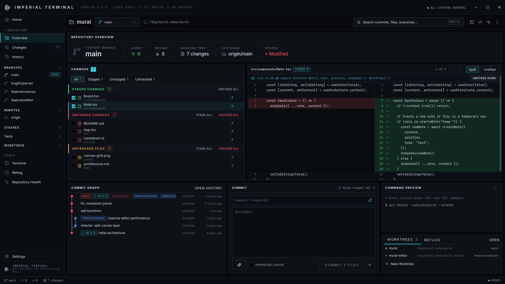
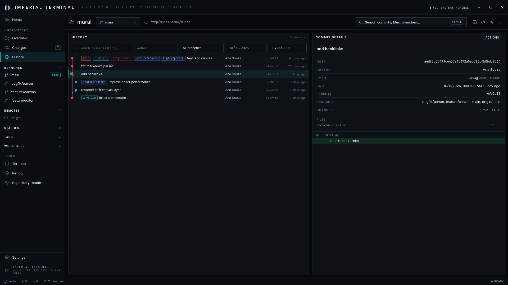
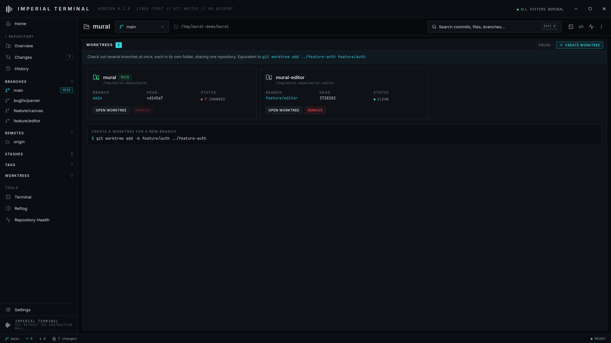

# Imperial Terminal

**A Linux-first Git client that doesn't hide Git.**

Imperial Terminal is a local-first desktop Git client with a tactical, terminal-inspired interface. It is a graphical front end for the `git` already installed on your machine, and every action shows the real command behind it, so the app teaches Git while staying useful for people who already know it.



## Highlights

- **Commit graph** – virtualized, lane-based graph that stays fluid on repositories with tens of thousands of commits
- **Changes** – staged / unstaged / untracked groups with split and unified diffs
- **Hunk staging** – stage, unstage or discard individual hunks through `git apply`
- **Branches** – checkout, create, rename, delete, merge and rebase with ahead/behind counters
- **Worktrees** – first-class worktree manager (`git worktree add/list/remove/prune`)
- **Interactive rebase** – reorder by drag and drop, pick / reword / edit / squash / fixup / drop, with an exact summary before anything runs
- **Conflict resolution** – OURS / RESULT / THEIRS editor, `git add` when resolved, continue or abort the operation
- **Reflog** – visual timeline of where HEAD has been
- **Repository health** – size, loose objects, stale branches, large files and dangling objects; suggests commands but never runs them
- **Git command previews** – a global panel shows the command before and after every operation
- **Safety layer** – destructive operations show the command and the impact, and need explicit confirmation
- **Keyboard first** – command palette, branch quick switcher, `J`/`K` history navigation
- **Linux-first, local-first** – no account, no telemetry, no backend, works offline

| History | Worktrees |
| --- | --- |
|  |  |

## Architecture

```
React UI
   ↓  Tauri commands (typed)
Rust Git service
   ↓  argv, never a shell
Git CLI
   ↓
Repository .git
```

```
src/                    React + TypeScript (strict) + Tailwind
  app/ components/ features/ hooks/ lib/ stores/ styles/ types/
src-tauri/src/
  commands/             thin Tauri command layer, repository allowlist
  git/                  one module per concern: status, log, branch, diff, stash, tag,
                        remote, worktree, reflog, rebase, conflict, config, health
  process/              shell-free process runner with timeouts, terminal/editor launchers
  filesystem/           local state store, SSH diagnostics, debounced repository watcher
  security/             path and ref validation, output sanitising
```

Design rules:

- Git is executed with **separate arguments**, never through `sh -c`.
- The UI can only act on repositories that were explicitly opened.
- Paths are validated (no traversal, no symlink escapes); ref names go through `git check-ref-format`.
- Git output is treated as untrusted: ANSI sequences are stripped and nothing is rendered as HTML.
- Repository config is untrusted too: `core.fsmonitor`, external diff drivers and textconv are disabled for the commands the app runs.
- Read-only commands run with `GIT_OPTIONAL_LOCKS=0` so they never touch the index and cannot trigger the file watcher.
- The app never stores credentials. Authentication stays with your credential helper or SSH agent.

## Requirements

- Linux with WebKitGTK 4.1 (`webkit2gtk-4.1`) and GTK 3
- `git` in `PATH`
- To build: Node.js 20+, a stable Rust toolchain, and the [Tauri prerequisites](https://v2.tauri.app/start/prerequisites/#linux)

## Build

```bash
npm install

npm run tauri dev            # development
npm run check                # typecheck + lint + frontend tests
(cd src-tauri && cargo test) # backend tests

npm run tauri build          # release bundles (AppImage, .deb, .rpm)
```

Open a repository directly from the shell:

```bash
imperial-terminal /path/to/repo
```

## Keyboard shortcuts

| Keys | Action |
| --- | --- |
| `Ctrl K` | Command palette |
| `Ctrl Shift P` | Branch quick switcher |
| `Ctrl O` | Open repository |
| `Ctrl Enter` | Commit (composer focused) |
| `Ctrl F` | Search commits (History) |
| `J` / `K` | Next / previous commit |
| `Esc` | Close dialog or panel |
| `?` | Show shortcuts |

## UI smoke tests

Debug builds include an optional hook for scripted UI checks: when `IT_AUTOMATION` points to a JavaScript file it is evaluated in the main window after startup, and `IT_REPORT_DIR` receives the report. Release builds contain none of this.

---

*Git without the abstraction wall.* No analytics. No tracking. No cloud required.
